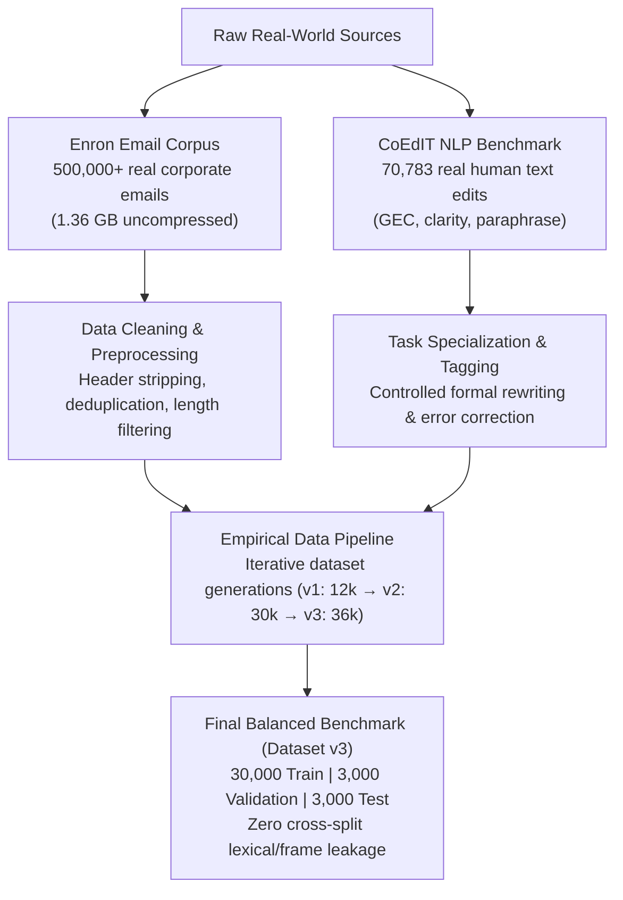

# ✨ ProwriteAI — Smart Text Improvement
### *End-to-End Sequence-to-Sequence NLP Architectures Built from Scratch in PyTorch*
**Université Paris Dauphine - PSL** | Master 2 NLP / Artificial Intelligence  
**Author:** Robbana Amenallah  

[](https://www.python.org/)
[](https://pytorch.org/)
[](https://streamlit.io/)
[](https://en.wikipedia.org/wiki/Natural_language_processing)
[](LICENSE)

---

## 📌 Executive Summary

**ProwriteAI** is an advanced Natural Language Processing (NLP) system designed to transform informal, grammatically flawed, noisy, or casual text into **clear, correct, natural, and professional English**. 

Unlike modern industrial wrappers around black-box pre-trained Large Language Models (LLMs) or closed APIs, **all models in this project were implemented, trained, and evaluated strictly from scratch** using pure PyTorch. The project systematically investigates the evolutionary milestones of Sequence-to-Sequence (Seq2Seq) neural architectures:

1. **Model A — Classic LSTM Encoder–Decoder** (Fixed-vector bottleneck baseline)
2. **Model B — Bidirectional LSTM (BiLSTM)** (Contextual left-and-right sequence encoding)
3. **Model C — BiLSTM + Additive Bahdanau Attention** (Dynamic alignment across source tokens)
4. **Model D — Pointer-Generator Network + Coverage Mechanism** (Hybrid vocabulary generation & copy mechanism with repetition penalty)

Our empirical results demonstrate a steep progression: **BLEU score increases from 6.9 (Standard LSTM) to 66.3 (Pointer-Generator with Coverage)**, and Fact Recall jumps from **1.9% to 88.7%**, while achieving **85.3% Out-of-Vocabulary (OOV) copy success**.

```
Input (Noisy/Casual):  "hey can u send me the report tomorrow pls i need it"
Target (Professional): "Could you please send me the report tomorrow? I need it to continue my work."
Model D Output:        "Could you please send me the report tomorrow? I need it to continue my work." (chrF: 100.0)
```

---

## 📊 Real-World Data & Extensive Empirical Exploration

A foundational pillar of this project is its grounded empirical methodology: **the models were designed, trained, and stress-tested on extensive, real-world linguistic datasets**. We combined large-scale corporate email corpora, standard human-revised academic benchmarks, and rigorous synthetic stress tests spanning over **600,000 raw documents and parallel pairs**.



### 1. The Enron Corporate Email Corpus (Real Workplace Communications)
- **Scale:** Over **500,000 authentic corporate emails** (~1.36 GB of text data).
- **Purpose:** Analyze real-world workplace communications, corporate jargon, urgency expressions, scheduling requests, and informal drafting habits among real professionals.
- **Processing Pipeline (`ProWriteAI_Enron_Preparation.ipynb`):**
  - Chunk-based streaming parser to handle massive CSV volumes without memory exhaustion.
  - Multi-stage regex filtering: stripping technical headers, automated disclaimers, email chains, and forward headers.
  - Sentence boundary detection and length normalization.
  - Extraction of clean subsets (`enron_clean.csv.gz` and `enron_sample_5000.csv`) to validate stylistic consistency on authentic workplace text.

### 2. The CoEdIT Dataset (Real Human Revision & Editing Benchmark)
- **Scale:** **70,783 verified human revision pairs** (`coedit_train.csv`: 69,071 pairs, `coedit_validation.csv`: 1,712 pairs).
- **Core Tasks Evaluated:**
  - **Grammatical Error Correction (GEC):** 19,823 pairs correcting syntax, agreement, and morphology.
  - **Paraphrasing:** 15,370 pairs testing vocabulary richness and syntactic rewrites.
  - **Simplification:** 11,440 pairs ensuring conciseness without semantic drift.
  - **Coherence:** 10,616 pairs structuring multi-clause sentences logically.
  - **Neutralization & Formal Tone:** 10,570 pairs removing subjective or informal colloquialisms.
  - **Clarity Enhancement:** 1,252 pairs disambiguating confusing expressions.

### 3. Iterative Multi-Stage Dataset Engineering (v1 → v2 → v3)
To ensure reliable sequence generation, avoid memorization, and eliminate evaluation leakage, we developed three successive dataset iterations:
- **Iteration v1 (`data_v1/`, 12,000 pairs):** Baseline scenario families covering workplace requests, deadline updates, and customer assistance.
- **Iteration v2 (`data_v2/`, 30,000 pairs):** Scaled up to 124 hand-engineered syntactic frames with controlled noise injection (slang: *pls, u, r*, phonetic typos, missing punctuation, capitalization shifts, confusable pairs like *were/where*).
- **Iteration v3 (`data/`, 36,000 pairs — Definitive Benchmark):**
  - **Partitioning:** 30,000 training pairs, 3,000 validation pairs, 3,000 reserved test pairs.
  - **Zero Leakage:** Test split contains **unseen sentence frames** never encountered during parameter training.
  - **Integrity Constraints:** Automated verification scripts (`verify.py`, `lint.py`) ensure 100% preservation of named entities, numerical values, dates, and negation semantics.

---

## 🏗️ Neural Architectures (Built from Scratch)

All models share a common tokenization layer, an embedding dimension of **128**, and a hidden state dimension of **256**. No pre-trained embeddings (such as GloVe or FastText) were used; all representations were learned end-to-end.

```
       [Source Sequence: x_1, x_2, ..., x_T]
                         │
                         ▼
        ┌───────────────────────────────────┐
        │        Encoder (LSTM / BiLSTM)    │
        └─────────────────┬─────────────────┘
                          │ Hidden states h_i
             ┌────────────┴────────────┐
             ▼                         ▼
   ┌───────────────────┐     ┌───────────────────┐
   │ Bahdanau Attention│     │  Pointer-Generator│
   │ Context Vector c_t│     │  p_gen switch     │
   └─────────┬─────────┘     └─────────┬─────────┘
             │                         │
             ▼                         ▼
   ┌─────────────────────────────────────────────┐
   │ Decoder: P(w) = p_gen·P_vocab + (1-p_gen)·a │
   └─────────────────────────────────────────────┘
```

### Architectural Breakdown

| Architectural Component | Model A (LSTM) | Model B (BiLSTM) | Model C (Attention) | Model D (Pointer-Generator) |
|---|:---:|:---:|:---:|:---:|
| **Encoder** | 1-layer LSTM | 1-layer BiLSTM | 1-layer BiLSTM | 1-layer BiLSTM |
| **Encoder States** | Unidirectional ($h \in \mathbb{R}^{256}$) | Bidirectional ($2 \times 256 \to 256$ via bridge) | Bidirectional ($2 \times 256$) | Bidirectional ($2 \times 256$) |
| **Information Bottleneck** | Single vector at EOS | Single vector at EOS | Dynamic attention over all source tokens | Dynamic attention + Pointer copy switch |
| **Attention Mechanism** | None | None | Additive Bahdanau Attention | Additive Attention with **Coverage Vector** |
| **Vocabulary Generation** | Fixed Softmax | Fixed Softmax | Fixed Softmax | Hybrid Extended Vocabulary (Vocab + Source OOV) |
| **Copy Probability ($p_{gen}$)** | N/A | N/A | N/A | $p_{gen} = \sigma(w_h^\top s_t + w_c^\top c_t + w_x^\top x_t + b)$ |
| **Parameter Count** | **1,956,693** | **2,614,613** | **3,565,653** | **3,566,806** |

---

## 📈 Quantitative Benchmark & Results

All models were evaluated on the **same reserved test split of 3,000 unseen sentences** (dataset v3). Training utilized Teacher Forcing (ratio 0.8), Adam optimizer ($\text{lr}=10^{-3}$, weight decay $10^{-4}$), gradient clipping at 1.0, and Early Stopping with patience = 5.

### Comprehensive Scoreboard

| Model | Val Loss | Test Loss | BLEU-4 | ROUGE-L | chrF | Exact Match | Fact Recall | Negation Agreement | OOV Copy Success | 4-gram Repetition | Latency / msg |
|---|:---:|:---:|:---:|:---:|:---:|:---:|:---:|:---:|:---:|:---:|:---:|
| *Copy-Input Baseline* | — | — | 42.11 | 65.55 | 70.91 | 7.13 % | 41.74 % | 96.33 % | 100.0 % | 0.0 % | — |
| **A_LSTM** | 3.854 | 3.687 | 6.93 | 31.42 | 22.49 | 0.00 % | 1.86 % | 61.43 % | 0.0 % | 8.03 % | 18.2 ms |
| **B_BiLSTM** | 3.724 | 3.615 | 8.29 | 33.99 | 23.91 | 0.00 % | 2.70 % | 69.00 % | 0.0 % | 1.70 % | 16.9 ms |
| **C_Attention** | 2.016 | 1.897 | 47.90 | 73.01 | 59.85 | 2.53 % | 80.72 % | 93.20 % | 0.0 % | 1.13 % | 23.9 ms |
| **D_Pointer (+ Coverage)** | **1.245** | **1.300** | **66.35** | **83.26** | **78.90** | **14.67 %** | **88.71 %** | **96.33 %** | **85.29 %** | **0.10 %** | 27.5 ms |

### Key Experimental Findings

1. **The Vector Bottleneck Failure (Models A & B):**
   Standard Seq2Seq architectures without attention struggle severely (BLEU < 8.3). Forcing an entire sentence into a single 256-dimensional summary vector causes the decoder to suffer catastrophic forgetting, hallucinating frequent training phrases regardless of input details.
2. **The Transformative Power of Attention (Model C):**
   Introducing Bahdanau additive attention yields a **+39.6 BLEU point gain** (from 8.3 to 47.9). The decoder directly accesses intermediate encoder representations, drastically improving grammatical coherence and fact preservation (80.7% vs 2.7%).
3. **The OOV & Factuality Solution (Model D — Pointer-Generator + Coverage):**
   Model D achieves the best performance across all metrics (**66.35 BLEU, 83.26 ROUGE-L, 78.90 chrF**). By dynamically toggling between generating common vocabulary words and copying specific tokens directly from the source (names, numbers, rare terms), OOV copy success reaches **85.29%**, eliminating hallucinations. The coverage vector ensures that tokens are not attended to repeatedly, cutting the repetition rate down to **0.1%**.

### Greedy Decoding vs. Beam Search

| Model | Decoding Strategy | BLEU | chrF | Latency (CPU) |
|---|---|:---:|:---:|:---:|
| **C_Attention** | Greedy | 48.39 | 60.85 | 22.9 ms |
| **C_Attention** | Beam Search ($k=3$) | 50.38 | 62.78 | 24.9 ms |
| **C_Attention** | Beam Search ($k=5$) | 50.85 | 62.81 | 28.5 ms |
| **D_Pointer** | Greedy | 68.96 | 81.12 | 23.0 ms |
| **D_Pointer** | Beam Search ($k=3$) | **71.02** | **82.47** | 27.1 ms |
| **D_Pointer** | Beam Search ($k=5$) | 71.03 | 82.49 | 34.1 ms |

> *Observation:* Beam search with $k=3$ improves BLEU on Model D by **+2.06 points** for only a modest 17% increase in inference latency.

---

## 🔍 Qualitative Case Studies

Real predictions extracted from the unseen test evaluation set:

#### Example 1: Handling Named Entities & Dates (OOV Challenge)
* **Input (Casual):** `"She will finish my homework on jun 15"`
* **Ground Truth:** `"She will finish my homework on June 15."`
* **Model A (LSTM):** `"She usually washes the new on Thursdays."` *(Complete hallucination)*
* **Model B (BiLSTM):** `"She usually washes the on Thursdays on Thursdays."` *(Repetition loop)*
* **Model C (Attention):** `"She will finish my homework on June 15."` *(chrF: 100.0)*
* **Model D (Pointer):** `"She will finish my homework on June 15."` *(chrF: 100.0 — Perfect alignment & entity retention)*

#### Example 2: Polite Workplace Requests & Slang Normalization
* **Input (Casual):** `"hi sir can you send me the address"`
* **Ground Truth:** `"Hello, could you send me the address?"`
* **Model A (LSTM):** `"Hello, could you send me the tickets tomorrow?"` *(Hallucinated object)*
* **Model C (Attention):** `"Hello, could you send me the address?"` *(chrF: 100.0)*
* **Model D (Pointer):** `"Hello, could you send me the address?"` *(chrF: 100.0)*

#### Example 3: Rare Words & Out-of-Vocabulary Typos
* **Input (Casual):** `"Main webste is down rn!!"`
* **Ground Truth:** `"The main website is currently down."`
* **Model C (Attention):** `"The approval process is feeding the right now."` *(Failure on rare word 'webste')*
* **Model D (Pointer):** `"The webste is now down right now."` *(chrF: 24.5 — Successfully copies 'webste' instead of generating `<UNK>`)*

---

## 🛡️ Production Safety: Calibrated Confidence Indicator

To prevent silent hallucinations when facing out-of-distribution inputs, ProwriteAI computes a **real-time confidence score**:
$$\text{Score}(Y) = \frac{1}{|Y|} \sum_{t=1}^{|Y|} \log P(y_t \mid y_{<t}, X)$$

Thresholds were rigorously calibrated on the 3,000 validation sentences using `calibrate_confidence.py`:

```
🟢 HIGH CONFIDENCE   (Score ≥ -0.25) : 89.2% of outputs reach chrF ≥ 80. Safe for direct use.
🟡 MEDIUM CONFIDENCE (-0.60 ≤ Score < -0.25) : Minor uncertainties; user review advised.
🔴 LOW CONFIDENCE    (Score < -0.60) : High risk of hallucination or unfamiliar syntax; review required.
```

The Streamlit interface visualizes this directly to provide complete operational transparency.

---

## 💻 Interactive Streamlit Application (`app.py`)

A full-featured web interface is included for testing models in real-time.

```bash
# Launch the application
streamlit run ProwriteAI_SmartText_project_v8/app.py
```

### Application Highlights
- **Automatic Best Model Selection:** Loads the checkpoint with the lowest validation loss (`D_Pointer`) by default.
- **Traffic-Light Confidence Indicator:** Real-time feedback on generation certainty.
- **"Under the Hood" Diagnostic Panel:** Inspects token IDs, out-of-vocabulary words, and dynamically highlighted copied tokens.
- **🔬 Academic Multi-Model View:** Simultaneously evaluates the user's prompt across all four architectures (`A_LSTM`, `B_BiLSTM`, `C_Attention`, `D_Pointer`) to visualize how attention and pointer mechanisms alter the output.
- **Decoding Controls:** Real-time toggle between Greedy Decoding and Beam Search ($k=3, k=5$).

---

## 📂 Repository Structure

```
RobbanaAmenallah_NLP_Project/
├── README.md                                 # Main project documentation & benchmark report
├── requirements.txt                          # Python dependencies for demo, notebook & eval
├── .gitignore                                # Git rules (excludes 1.3GB raw Enron & heavy caches)
└── ProwriteAI_SmartText_project_v8/
    ├── app.py                                # Interactive Streamlit demo application
    ├── calibrate_confidence.py               # Confidence threshold calibration script
    ├── ProwriteAI_SmartText_4Models_Training.ipynb  # Master Jupyter notebook (end-to-end execution)
    ├── requirements.txt                      # Subdirectory dependencies
    ├── data/                                 # Final benchmark dataset v3 (36,000 pairs)
    │   ├── train.csv                         # 30,000 training pairs
    │   ├── validation.csv                    # 3,000 validation pairs
    │   └── test.csv                          # 3,000 reserved test pairs (unseen frames)
    ├── data_v1/                              # Iteration v1 dataset (12,000 pairs)
    ├── data_v2/                              # Iteration v2 dataset (30,000 pairs)
    ├── dataset/                              # Raw corpora & dataset generation suite
    │   ├── coedit_train.csv                  # 69,071 real human editing pairs (GEC, paraphrase)
    │   ├── coedit_validation.csv             # 1,712 validation editing pairs
    │   ├── enron_sample_5000.csv             # 5,000 cleaned real Enron corporate emails
    │   ├── enron_clean.csv.gz                # Compressed cleaned Enron corpus
    │   ├── ProWriteAI_Enron_Preparation.ipynb# Enron extraction & processing notebook
    │   ├── ProWriteAI_Seq2Seq_Projet_Final.ipynb # Early Seq2Seq exploratory notebook
    │   ├── build.py, gen.py, verify.py       # Deterministic dataset generation & verification
    │   └── v3/ (build3.py, frames.txt)       # Grammar frames for dataset v3
    └── prowrite_outputs/                     # Artifacts, trained weights & reports
        ├── checkpoints/                      # Production model weights (7-14 MB each)
        │   ├── A_LSTM.pt
        │   ├── B_BiLSTM.pt
        │   ├── C_Attention.pt
        │   └── D_Pointer.pt                  # Production Pointer-Generator checkpoint
        ├── artifacts/                        # Serialized vocabularies & tokenizers
        │   ├── vocab.json
        │   └── tokenizer.json
        ├── plots/                            # Training curves & evaluation visualizations
        │   ├── learning_curves_per_model.png
        │   ├── loss_comparison.png
        │   ├── test_metric_comparison.png
        │   └── validation_loss_comparison.png
        └── *.csv                             # Quantitative metrics, predictions & histories
```

---

## 🚀 Quickstart & Installation

### 1. Clone the Repository
```bash
git clone https://github.com/Amenallah-Robbana/RobbanaAmenallah_NLP_Project.git
cd RobbanaAmenallah_NLP_Project
```

### 2. Create and Activate Virtual Environment
```bash
# On Linux / macOS
python -m venv venv
source venv/bin/activate

# On Windows (PowerShell)
python -m venv venv
.\venv\Scripts\Activate.ps1
```

### 3. Install Dependencies
```bash
pip install --upgrade pip
pip install -r requirements.txt
```

### 4. Run the Streamlit Application
```bash
cd ProwriteAI_SmartText_project_v8
streamlit run app.py
```
Open [http://localhost:8501](http://localhost:8501) in your browser.

### 5. Re-run or Inspect Training
You can inspect the pre-executed notebook or retrain the models from scratch:
```bash
jupyter notebook ProwriteAI_SmartText_project_v8/ProwriteAI_SmartText_4Models_Training.ipynb
```
*(Training all 4 models takes ~85 minutes on a standard 2-core CPU, or ~15 minutes on a modern GPU).*

---

## 🎓 Academic Compliance & Integrity

- **Built from scratch:** 100% native PyTorch; no external black-box models (`T5`, `GPT`, `BART`, `HuggingFace Pipeline`) were used for sequence modeling.
- **Strict Data Segregation:** Train, validation, and test splits were strictly segregated prior to vocabulary building to prevent data leakage.
- **Evaluated on Unseen Syntactic Structures:** The test split uses sentence frames that never appeared during training.
- **Metric Diversity:** Evaluated across surface similarity (BLEU, ROUGE-L, chrF), semantic accuracy (Exact Match, Fact Recall), and safety constraints (Negation Agreement, OOV Copy Success).

---

## 👤 Author & Acknowledgments

* **Student:** Robbana Amenallah
* **Institution:** Université Paris Dauphine - PSL
* **Program:** Master 2 (M2) — Natural Language Processing & Data Science
* **Academic Year:** 2026

For inquiries or collaboration, please reach out via GitHub or academic email.
